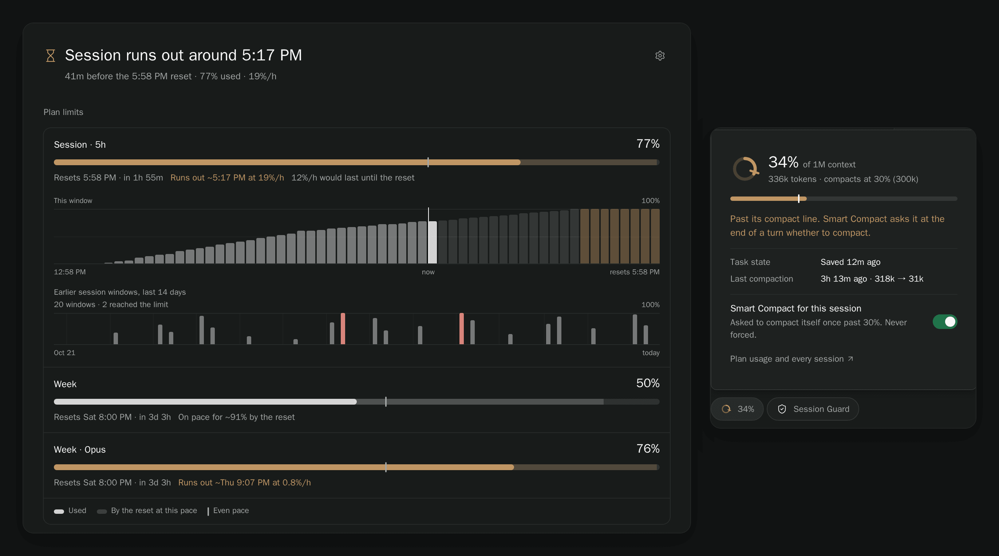
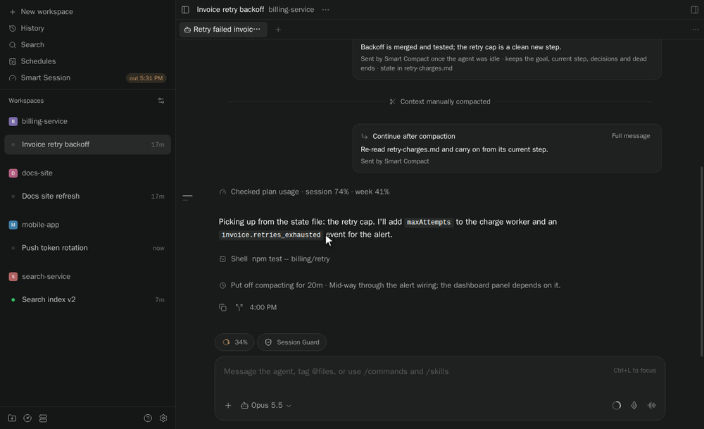
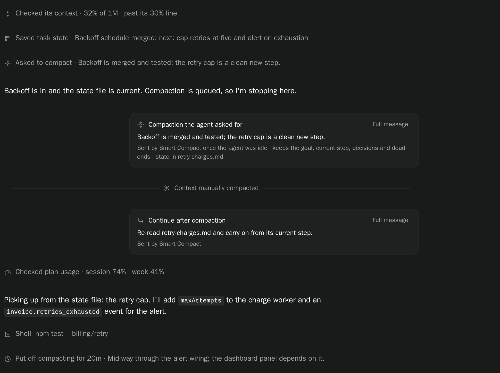
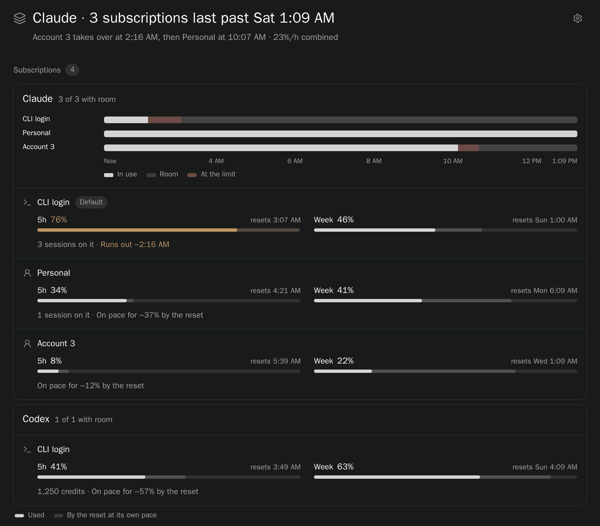
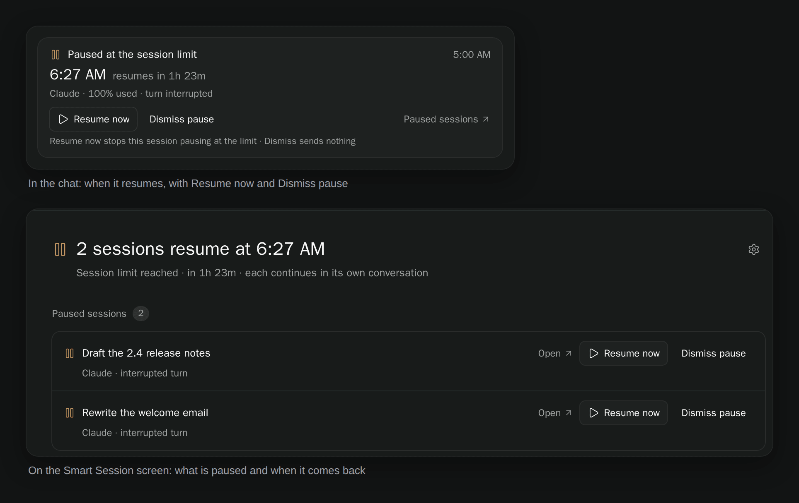
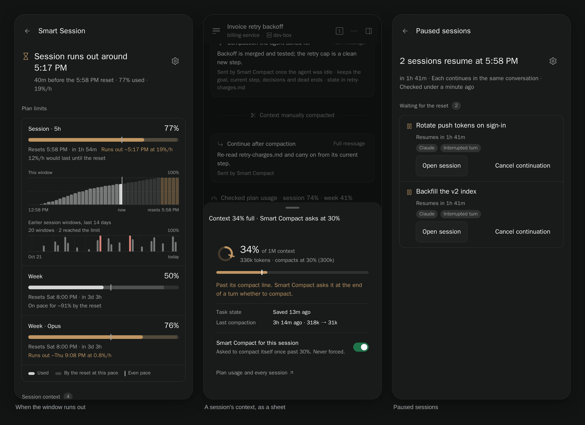
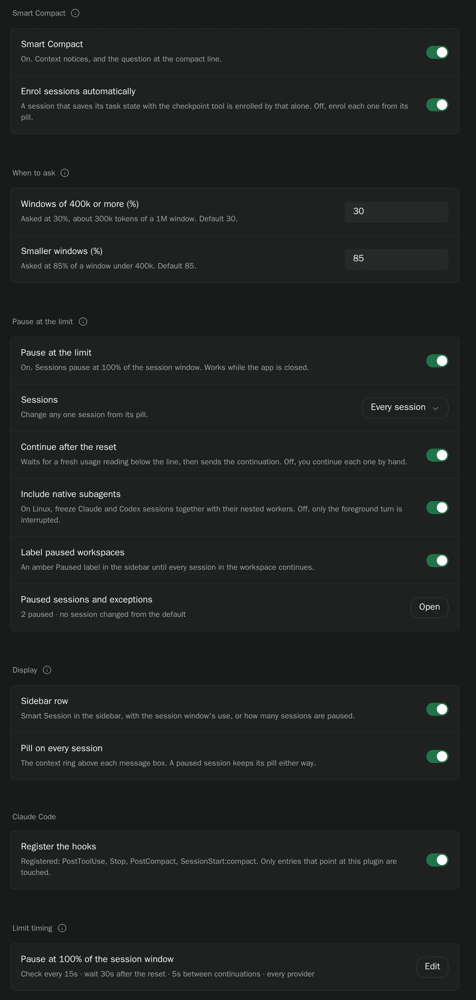

# paseo-smart-session

[](https://www.npmjs.com/package/paseo-smart-session)
[](https://www.npmjs.com/package/paseo-smart-session)
[](https://paseo.sh)
[](LICENSE)

Know when your plan runs out, and let agents manage their own long-running work. Smart Session records your Claude plan usage and turns it into a forecast ("Session runs out around 5:40 PM"), shows how full each session's context is, lets an agent save its task state and compact itself at a safe point, and pauses work at the session limit to continue it after the reset.

<picture>
  <source media="(prefers-color-scheme: light)" srcset="docs/media/smart-session-hero-light.png">
  
</picture>

Screenshots use synthetic usage history and sessions.

## Install

```sh
paseo plugin install paseo-smart-session
```

On first load it registers its Claude Code hooks, touching only entries that point at its own scripts. Its agent tools are attached when an interactive session opens: on Paseo 0.15+ they are served through the agent's own Paseo MCP (`smart_checkpoint`, `smart_request_compaction`, …) with no process per agent, and on 0.14 each session gets its own `mcp.mjs` stdio server. Nothing is registered globally; an older version's global `smart-session` entry is removed on load, with a backup beside the file.

## Use

**Smart Session** in the sidebar opens the overview. Its headline says when the session window runs out at the current pace, or that it lasts until the reset. While sessions are paused at the limit it leads with them instead ("2 sessions resume at 5:58 PM"), and lists them first with their actions.

- **Plan limits.** Each window (the 5-hour session, the week, per-model weekly caps) shows how much is used, when it resets, and where it lands at the current pace: a faint extension of the meter, and a tick where an even pace would be. The session window adds a chart of its recorded usage and the projection to the reset, plus every session window of the last 14 days, so you can see how often you hit the limit.
- **Session context.** Every open session with its share of the context window, the line where Smart Compact asks it to compact, how fast it is filling, and whether it is enrolled. Press a row to open the session.
- **Smart Compact and Pause at the limit.** One switch each, what they will do next, and the sessions you changed from your default.
- **Tokens, last 30 days.** Billable tokens, the cache hit rate and the subagent share, per day, by hour of the week, by workspace and by model, reconstructed from Claude Code's transcripts.

Each session has one pill above its message box: a ring of its context, with a tick at each of its two compact lines. Press it to see the detail, when it last saved its task state and compacted, and to switch Smart Compact and Pause at the limit for that session. When the session is paused at the limit the same pill turns amber and says when it resumes, and it stays up even if you hide the pill.




Agents get these tools:

| Tool | What it does |
| --- | --- |
| `context_status` | Current context usage, fill rate and thresholds |
| `checkpoint` | Save durable task state for this session |
| `request_compaction` | Queue `/compact`, and choose whether and how to continue afterwards |
| `defer_compaction` | Put off a compaction and record why |
| `budget_status` | Plan usage, burn rate and reset times, and whether this session pauses at the limit |

The usual flow is `context_status → checkpoint → request_compaction`, then stop or re-read the state and continue. Saved state holds the goal, current step, decisions made and approaches that failed, so a resumed agent neither redoes work nor asks how to continue. In the chat each call is one line ("Saved task state · Cap retries at five", "Asked to compact · …"), and the messages Smart Session sends show as small cards with the full text one press away.



## How Smart Compact works

As a session fills, hooks send context notices. Each window size has two lines. Past the first (the end-of-turn line), the agent is asked at the end of its turn whether it wants to compact. Past the second (the mid-turn line), it is asked straight away, to finish only the step it is on, checkpoint, request the compaction and end its turn so the compaction can land. Nothing is forced: the agent can compact, defer with a reason, or keep working. A request is delivered only when the agent is idle and its state file is current; `request_compaction` refuses a missing or stale one.

After compaction, the agent chooses to stop (`continue_after_compaction: false`), continue with the default prompt to re-read its state, or continue with its own `continue_message`. A `/compact` typed by a person never gets a plugin continuation.

The forecast uses the last half hour for the session window and the window's own average for a week, so a burst of work doesn't read as "the week runs out tonight".

## Every ZeroSub subscription

With [ZeroSub](https://github.com/kapybara-org/zerosub) running several Claude or Codex subscriptions, the question becomes how long all of them last, which one is next, and whether the work makes it to a reset. ZeroSub manages the accounts; Smart Session adds the time.

- **The pool, as a time.** The overview leads with "Claude · 3 subscriptions last until about 9:40 PM", or "Both Claude subscriptions are at the limit · first one back at 5:58 PM". The forecast runs each account's own pace forward and moves work the way ZeroSub does, to the account with the most room, through each account's resets.
- **A runway.** One lane per account across the next 12 hours: in use, room, at the limit. Reading down a column says who carries the work then.
- **One row per account.** The name you gave it in ZeroSub (else "CLI login" or "Account 2", never the email), the 5-hour and weekly windows with their resets, the sessions on it, when it runs out, and how old its reading is. Codex credits show when ZeroSub reports them.
- **Everywhere else.** The sidebar row summarises the pool, amber or red only when the pool is in trouble. The pill's popover says which subscription the session runs on and what happens at its limit. `budget_status` tells agents the pooled runway and which account is next.

Smart Session keeps each account's readings in its own history (by ZeroSub's account id, never the email), so every account has a pace. ZeroSub's files are only read. A reading older than half an hour says so and adds no pace. Without ZeroSub, nothing changes.

<picture>
  <source media="(prefers-color-scheme: light)" srcset="docs/media/smart-session-subscriptions-light.png">
  
</picture>

## In Paseo's own usage card (Paseo 0.16+)

On Paseo 0.16 or newer, Smart Session is also one of Paseo's usage sources, named **Claude · Smart Session**. Its cards show in the context window details (the composer's context meter), in the Usage screen and in the sidebar usage summary. On older Paseo nothing changes.

- **The session's own account first,** with each window's forecast: Paseo shows "runs out in 1h 40m" where the reset line was, and the bar turns amber or red only when the pace says the window runs out before it resets. Session, Weekly and every Weekly · model window that the account reports.
- **Every other ZeroSub Claude account** as its own card: at the limit (and when it is back), set aside, next to take over, and how old its reading is when that is over half an hour.
- **The pool** on the session's card: "3 accounts · run out in 6h 20m at this pace".
- **Paseo's own Claude card steps aside** on web and desktop while Smart Session's card for the same login is on screen with a fresh reading. The logins are matched by a hash of the email, so the email is never copied out of ZeroSub's files. When the reading is stale or missing, or the logins can't be matched, Paseo's card stays. Turn this off under **Display → Replace Paseo's Claude usage card**. Phones show both cards.

Paseo's card shows a few things Smart Session's card can't: the plan tier suffix ("Team 5x" shows as "Team"), the login email (the card names the account as ZeroSub does, "CLI login", "Account 2" or the name you gave it), and Extra usage for accounts other than the CLI login until ZeroSub records it.

**Sidebar summary, once:** Paseo pins windows per source. To have the sidebar summary show Smart Session's windows instead of Paseo's, open **Usage**, unpin Claude's Session and Weekly, and pin Claude · Smart Session's. The choice is remembered.

## Pause at the limit (Session Guard)

When the provider's session window is spent, Smart Session pauses running sessions instead of letting them fail, and continues the same conversations once the window resets, even with the app closed. It is **off by default**: turn it on from the overview or in settings. It was the standalone [Session Guard](https://github.com/tomgrin10/paseo-session-guard) plugin, and its per-session choices and waiting pauses carry over.

On Linux, Claude and Codex sessions pause in place together with their native subagents; elsewhere the turn is interrupted and one continuation is sent after the reset. A paused session's pill, its chat and its workspace say so: the chat gets a card with the time it resumes, **Resume now** and **Dismiss pause**, which folds into one line once the pause ends. For Claude, a reset is confirmed from whichever is fresher, Paseo's cached usage or Smart Session's own recorder.



If the standalone Session Guard plugin is still enabled, it keeps doing the pausing and Smart Session says so in one line, so a session is never paused twice. Disable or uninstall it to hand over. See the [guide](docs/session-guard.md) for timing and limits.

On a phone, the pill opens as a sheet and every screen fits one column.



## Settings

Everything is on one screen, **Settings → Plugins → Smart Session**, in the order a session meets it. ⌘K **Smart Session: settings** opens it.

| Section | Setting | Default | |
| --- | --- | --- | --- |
| Smart Compact | Smart Compact | On | Context notices and agent-requested compaction |
| | Enrol sessions automatically | On | Enrol a session once it writes task state |
| When to ask | 400k+ windows · end of turn | 30% | Where large windows are asked when a turn ends |
| | 400k+ windows · mid-turn | 40% | Where large windows are asked mid-turn; must be above the end-of-turn line |
| | Smaller windows · end of turn | 85% | Where smaller windows are asked when a turn ends |
| | Smaller windows · mid-turn | 90% | Where smaller windows are asked mid-turn |
| Pause at the limit (Session Guard) | Pause at the limit (Session Guard) | Off | Pause sessions at the session limit |
| | Sessions | Every session | Or only the ones you turn on from their pill |
| | Continue after the reset | On | Off, you continue each one by hand |
| | Include native subagents | On | Freeze nested workers too (Linux) |
| | Label paused workspaces | On | An amber Paused label in the sidebar |
| Display | Sidebar row | On | |
| | Pill on every session | On | A paused session keeps its pill either way |
| | Replace Paseo's Claude usage card | On | Paseo 0.16+, web and desktop |
| Claude Code | Register the hooks | On | Keep the context and compaction hooks installed |
| Limit timing | Pause at, check interval, wait after reset, spacing, continuation message, providers, windows | 100%, 15s, 30s, 5s | Behind **Edit**; each field is checked on its own |

Hiding the row or the pill never turns a feature off.



## Data and access

Everything lives in `$PASEO_HOME/plugin-data/smart-session/`: monthly usage and context logs (and, with ZeroSub, a monthly log of each subscription's readings, keyed by account id), compaction records, an hourly spend index by model, workspace and agent type, and one `state/<agentId>.md` per agent. Logs are append-only, and a damaged line is skipped rather than risking the rest.

Paseo plugins run trusted, unsandboxed code on the daemon host. Smart Session reads local Claude Code usage data, reads ZeroSub's account registry and usage readings when ZeroSub is enabled (never its account homes or credentials), and talks only to the local daemon. For password-protected daemons it reads `PASEO_PASSWORD`, then `PASEO_PASSWORD_FILE`, then `~/paseo-hub/secrets/daemon-password`, and never writes or logs it.

## Development

```sh
npm ci
npm run verify
paseo plugin install .
paseo plugin reload smart-session   # after changes
```

## License

[MIT](LICENSE) © 2026 Tom Gringauz.

## Other plugins

- [Defer](https://github.com/tomgrin10/paseo-defer) — Schedule messages for later delivery.
- [Follow-up](https://github.com/tomgrin10/paseo-follow-up) — Track workspace PRs, remaining tasks and completion.
- [Send to Paseo](https://github.com/tomgrin10/send-to-paseo) — Send GitHub and Graphite PRs to Paseo from Chrome.
- [Session Guard](https://github.com/tomgrin10/paseo-session-guard) — Pause at session limits and continue after reset.
- [Transcript Search](https://github.com/tomgrin10/paseo-transcript-search) — Search conversations across connected hosts.
- [Transfer](https://github.com/tomgrin10/paseo-transfer) — Copy or move workspaces between hosts.
- [Vitals](https://github.com/tomgrin10/paseo-vitals) — Host, process, agent and Docker monitoring.
- [Workspace Switcher](https://github.com/tomgrin10/paseo-switcher) — Arc-style Ctrl+Tab between recent workspaces.
