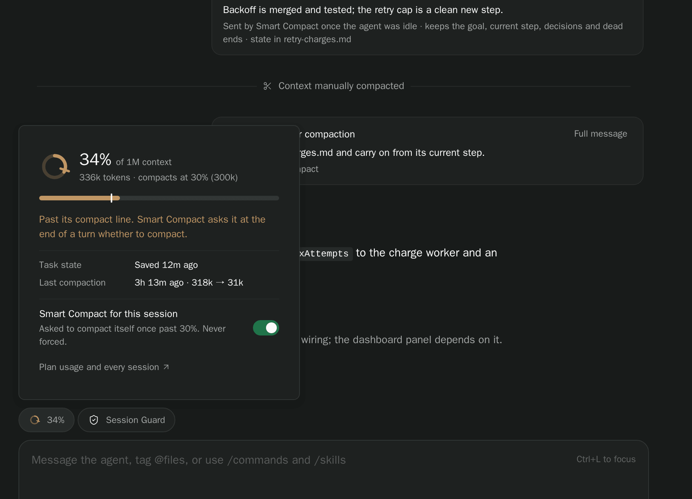

# paseo-smart-session

[](https://www.npmjs.com/package/paseo-smart-session)
[](https://www.npmjs.com/package/paseo-smart-session)
[](https://paseo.sh)
[](LICENSE)

Know when your plan runs out, and let agents manage their own long-running work. Smart Session records your Claude plan usage and turns it into a forecast ("Session runs out around 5:40 PM"), shows how full each session's context is, lets an agent save its task state and compact itself at a safe point, and with Session Guard pauses work at the session limit and continues it after the reset.

<picture>
  <source media="(prefers-color-scheme: light)" srcset="docs/media/smart-session-hero-light.png">
  
</picture>

Screenshots use synthetic usage history and sessions.

## Install

```sh
paseo plugin install paseo-smart-session
```

On first load it registers its Claude Code hooks, touching only entries that point at its own scripts. Paseo attaches its MCP server when an interactive session opens.

## Use

**Smart Session** in the sidebar opens the overview. Its headline says when the session window runs out at the current pace, or that it lasts until the reset.

- **Plan limits.** Each window (the 5-hour session, the week, per-model weekly caps) shows how much is used, when it resets, and where it lands at the current pace: a faint extension of the meter, and a tick where an even pace would be. The session window adds a chart of its recorded usage and the projection to the reset, plus every session window of the last 14 days, so you can see how often you hit the limit.
- **Session context.** Every open session with its share of the context window, the line where Smart Compact asks it to compact, how fast it is filling, and whether it is enrolled. Press a row to open the session.
- **Smart Compact and Session Guard.** One switch each, what they will do, and links to their settings.
- **Tokens, last 30 days.** Billable tokens, the cache hit rate and the subagent share, per day, by hour of the week, by workspace and by model, reconstructed from Claude Code's transcripts.

The pill above each message box is a ring of that session's context, with a tick at its compact line. Press it to see the detail, when it last saved its task state and compacted, and to enrol the session or take it out.




Agents get these tools:

| Tool | What it does |
| --- | --- |
| `context_status` | Current context usage, fill rate and thresholds |
| `checkpoint` | Save durable task state for this session |
| `request_compaction` | Queue `/compact`, and choose whether and how to continue afterwards |
| `defer_compaction` | Put off a compaction and record why |
| `budget_status` | Plan usage, burn rate and reset times, and whether Session Guard will pause this session |

The usual flow is `context_status → checkpoint → request_compaction`, then stop or re-read the state and continue. Saved state holds the goal, current step, decisions made and approaches that failed, so a resumed agent neither redoes work nor asks how to continue. In the chat each call is one line ("Saved task state · Cap retries at five", "Asked to compact · …"), and the messages Smart Session sends show as small cards with the full text one press away.


## How Smart Compact works

As a session fills, hooks send context notices. At the compact line, the agent is asked at the end of its turn whether it wants to compact. Nothing is forced: the agent can compact, defer with a reason, or keep working. A request is delivered only when the agent is idle and its state file is current; `request_compaction` refuses a missing or stale one.

After compaction, the agent chooses to stop (`continue_after_compaction: false`), continue with the default prompt to re-read its state, or continue with its own `continue_message`. A `/compact` typed by a person never gets a plugin continuation.

The forecast uses the last half hour for the session window and the window's own average for a week, so a burst of work doesn't read as "the week runs out tonight".

**Settings → Plugins → Smart Session → Smart Compact:**

| Setting | Default | |
| --- | --- | --- |
| Smart Compact | On | Context notices and agent-requested compaction |
| Enrol sessions automatically | On | Enrol a session once it writes task state |
| Context pill on every session | On | The ring above each message box |
| Windows of 400k or more | 30% | Where large windows are asked to compact |
| Smaller windows | 85% | Where smaller windows are asked to compact |
| Register the hooks | On | Keep the context and compaction hooks installed in Claude Code |

## Session Guard

Session Guard pauses agents at the provider's session limit and continues the same conversations after the reset, even with the app closed. It is the [Session Guard](https://github.com/tomgrin10/paseo-session-guard) plugin folded into Smart Session, and it is **off by default**: turn it on from the overview or **Settings → Plugins → Smart Session → Session Guard**.

On Linux, Claude and Codex sessions pause in place together with their native subagents; elsewhere the turn is interrupted and one continuation is sent after the reset. Each paused session gets a card in its chat with the reset time and a countdown, **Resume now** and **Dismiss pause**; once the pause ends the card folds into one line. **Paused sessions** lists every pause by its reset time, and the session's pill and its workspace read **Paused**. For Claude, a reset is confirmed from whichever is fresher, Paseo's cached usage or Smart Session's own recorder.


While the standalone plugin is enabled, Smart Session leaves session protection to it, so a session is never paused twice. Disable or uninstall Session Guard to hand over; per-session choices and waiting pauses in `$PASEO_HOME/plugin-data/session-guard/` carry over. See the [Session Guard guide](docs/session-guard.md) for settings and limits.

On a phone, the pill popovers open as sheets and every screen fits one column.


**Settings → Plugins → Smart Session → Display** hides the sidebar row or the composer pills; neither turns a feature off.

## Data and access

Everything lives in `$PASEO_HOME/plugin-data/smart-session/`: monthly usage and context logs, compaction records, an hourly spend index by model, workspace and agent type, and one `state/<agentId>.md` per agent. Logs are append-only, and a damaged line is skipped rather than risking the rest.

Paseo plugins run trusted, unsandboxed code on the daemon host. Smart Session reads local Claude Code usage data and talks only to the local daemon. For password-protected daemons it reads `PASEO_PASSWORD`, then `PASEO_PASSWORD_FILE`, then `~/paseo-hub/secrets/daemon-password`, and never writes or logs it.

## Development

```sh
npm ci
npm run verify
paseo plugin install .
paseo plugin reload smart-session   # after changes
```

## License

[MIT](LICENSE) © 2026 Tom Gringauz.

## Other plugins

- [Defer](https://github.com/tomgrin10/paseo-defer) — Schedule messages for later delivery.
- [Follow-up](https://github.com/tomgrin10/paseo-follow-up) — Track workspace PRs, remaining tasks and completion.
- [Send to Paseo](https://github.com/tomgrin10/send-to-paseo) — Send GitHub and Graphite PRs to Paseo from Chrome.
- [Session Guard](https://github.com/tomgrin10/paseo-session-guard) — Pause at session limits and continue after reset.
- [Transcript Search](https://github.com/tomgrin10/paseo-transcript-search) — Search conversations across connected hosts.
- [Transfer](https://github.com/tomgrin10/paseo-transfer) — Copy or move workspaces between hosts.
- [Vitals](https://github.com/tomgrin10/paseo-vitals) — Host, process, agent and Docker monitoring.
- [Workspace Switcher](https://github.com/tomgrin10/paseo-switcher) — Arc-style Ctrl+Tab between recent workspaces.
